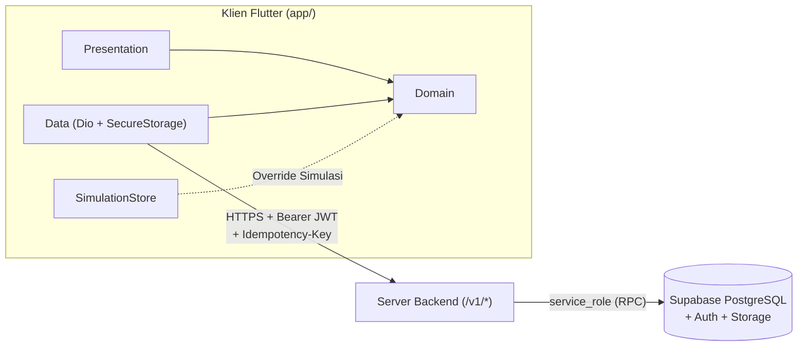

# KantinCerdas

> Aplikasi mobile Flutter untuk pemesanan makanan kantin kampus dengan pembayaran tunai saat pengambilan di stan bagi mahasiswa, pemilik stan, dan administrator.

[](.github/workflows/ci.yml)
[](.github/workflows/cd-release.yml)

## Tentang

KantinCerdas melayani tiga peran pengguna dalam satu aplikasi Flutter: pelanggan (`customer`), pemilik stan (`owner`), dan administrator (`admin`). Pelanggan menelusuri katalog menu, memesan makanan dari satu stan yang buka, memantau status persiapan, lalu mengambil pesanan dan membayar tunai langsung di stan. Pemilik stan mengelola profil kedai, ketersediaan menu, dan antrean pesanan, sedangkan administrator meninjau pengajuan pembukaan stan baru serta mengatur akses akun pengguna.

## Status

| Komponen | Kondisi | Catatan |
|---|---|---|
| Aplikasi Flutter (`app/`) | Berjalan | Seluruh antarmuka tiga peran, manajemen state, penyimpanan jurnal mutasi lokal, dan adapter HTTP telah tersedia. |
| Mode Simulasi (`app/test/support/`) | Berjalan | Berjalan mandiri di perangkat/emulator menggunakan database fiktif lokal tanpa akun cloud dan tanpa server. |
| Database Supabase (`server/supabase/`) | Berjalan | Migrasi tabel PostgreSQL, kebijakan Row Level Security, fungsi RPC transaksional, dan skrip pengujian telah tersedia. |
| Server Backend `/v1/*` (`backend/`) | Belum ada | Direktori server perantara belum ada di repositori ini, sehingga aplikasi baru dapat dijalankan penuh lewat Mode Simulasi atau diarahkan ke server eksternal. |
| Pipeline CI/CD (`.github/workflows/`) | Berjalan | Workflow pemeriksaan kualitas/build APK debug (`ci.yml`) dan rilis Android bertanda tangan (`cd-release.yml`) telah terpasang. |

## Teknologi

| Komponen / Paket | Versi | Keterangan |
|---|---|---|
| Aplikasi `kantin_cerdas` | `1.0.0+1` | Versi paket di `app/pubspec.yaml` |
| Flutter SDK | `>=3.44.0` (CI: `stable`) | Constraint SDK di `app/pubspec.lock` |
| Dart SDK | `>=3.12.2 <4.0.0` (constraint `^3.12.2`) | Bahasa pemrograman utama klien |
| Java / JDK | `17` | Target kompilasi Java/Kotlin Android (`JVM_17`) |
| Gradle / AGP / Kotlin | `9.1.0` / `9.0.1` / `2.3.20` | Toolchain build Android di `app/android/` |
| PostgreSQL (Supabase) | `16` | Versi mayor database di `server/supabase/config.toml` |
| `flutter` & `flutter_localizations` | `sdk` | Framework UI utama dan lokalisasi `id_ID` / `en_US` |
| `flutter_riverpod` | `3.4.3` (`^3.4.3`) | State management dan dependency injection |
| `go_router` | `18.0.1` (`^18.0.1`) | Navigasi deklaratif dan pengalihan rute per peran |
| `dio` | `5.11.1` (`^5.11.1`) | Klien HTTP ke endpoint `/v1/*` dan interceptor token |
| `flutter_secure_storage` | `11.2.0` (`^11.2.0`) | Penyimpanan terenkripsi untuk token sesi dan jurnal mutasi |
| `shared_preferences` | `2.5.5` (`^2.5.5`) | Penyimpanan pengaturan tampilan dan snapshot Mode Simulasi |
| `intl` | `0.20.2` (`^0.20.2`) | Pemformatan mata uang Rupiah (IDR) dan tanggal lokal |
| `characters` | `1.4.1` (`^1.4.1`) | Perhitungan panjang teks berbasis grapheme cluster Unicode |
| `flutter_lints` (`dev`) | `6.0.0` (`^6.0.0`) | Aturan analisis statis Dart/Flutter |
| `flutter_launcher_icons` (`dev`) | `0.14.4` (`^0.14.4`) | Generator ikon peluncur aplikasi Android |
| `flutter_native_splash` (`dev`) | `2.4.8` (`^2.4.8`) | Generator layar splash native Android |

Sumber kebenaran versi paket yang terpasang adalah `app/pubspec.lock`.

## Prasyarat

- **Flutter SDK `>=3.44.0`** (menyertakan **Dart `>=3.12.2 <4.0.0`**) — periksa dengan `flutter --version`.
- **JDK `17`** — periksa dengan `java -version`.
- **Android SDK & Emulator** (atau perangkat Android fisik dengan USB Debugging aktif) — periksa dengan `flutter doctor -v`.
- **Supabase CLI** *(opsional, hanya bila ingin mendorong migrasi SQL ke Supabase Cloud)* — periksa dengan `supabase --version`.

## Mulai Cepat

### A. Mode Simulasi (tanpa akun cloud dan tanpa server)

1. Klon repositori dan masuk ke direktori aplikasi Flutter:
   ```bash
   git clone https://github.com/Doni-15/kantin-cerdas.git
   cd kantin-cerdas/app
   ```
2. Unduh dependensi sesuai lockfile:
   ```bash
   flutter pub get --enforce-lockfile
   ```
3. Nyalakan emulator atau hubungkan perangkat Android (`flutter devices`), lalu jalankan entrypoint simulasi:
   ```bash
   flutter run -t test/support/main_simulation.dart
   ```
4. Gunakan tombol **Kontrol** pada pita atas layar untuk mengganti skenario jaringan atau mereset data simulasi.

<details>
<summary>Daftar akun demo (hanya mode simulasi — password semua akun: <code>Simulasi123!</code>)</summary>

| Username | Email | Peran | Keterangan |
|---|---|---|---|
| `pelanggan` | `pelanggan@example.test` | `customer` | Memiliki pesanan aktif dan riwayat; dapat mengajukan stan baru |
| `pelanggan2` | `pelanggan2@example.test` | `customer` | Memiliki pengajuan stan *Kedai Bima* yang menunggu tinjauan admin |
| `pemilik` | `pemilik@example.test` | `owner` | Pemilik stan *Dapur Nusantara* (Blok A, kondisi buka) |
| `pemilik2` | `pemilik2@example.test` | `owner` | Pemilik stan *Warung Mie Kampus* (Blok B, kondisi buka) |
| `pemilik3` | `pemilik3@example.test` | `owner` | Pemilik stan *Kedai Segar* (Blok C, kondisi tutup) |
| `admin` | `admin@example.test` | `admin` | Meninjau pengajuan kantin dan mengatur akses pengguna |

</details>

### B. Terhubung ke server

Kode server backend `/v1/*` belum tersedia di repositori ini; mode terhubung hanya dapat digunakan apabila Anda sudah memiliki endpoint server `/v1/*` aktif yang terhubung ke proyek Supabase Cloud.

1. Masuk ke folder `app/` dan buat berkas `app/dart_defines.json` (berkas ini diabaikan oleh Git):
   ```json
   {
     "API_BASE_URL": "https://api-staging.domain-anda.ac.id/v1"
   }
   ```
2. Jalankan entrypoint utama `lib/main.dart` dengan menyertakan berkas konfigurasi tersebut:
   ```bash
   cd app
   flutter run -t lib/main.dart --dart-define-from-file=dart_defines.json
   ```

## Konfigurasi

Variabel berikut dibaca saat kompilasi oleh klien Flutter di `app/lib/core/network/app_environment.dart`, `app/lib/core/config/app_build_info.dart`, dan `app/lib/core/config/app_feature_flags.dart`:

| Variabel (`--dart-define`) | Wajib? | Default | Fungsi |
|---|---|---|---|
| `API_BASE_URL` | Wajib pada mode server | `""` | URL dasar server REST API `/v1/*` (`http://` atau `https://`) |
| `APP_VERSION` | Opsional | `"1.0.0"` | Label versi yang ditampilkan di halaman Pengaturan |
| `SUPPORT_EMAIL` | Opsional | `"support@kantincerdas.ac.id"` | Alamat email dukungan di halaman Bantuan dan Ketentuan |
| `ENABLE_GOOGLE_AUTH` | Opsional | `false` | Menampilkan opsi login Google pada layar autentikasi |
| `ENABLE_PROFILE_PHOTO_UPLOAD` | Opsional | `true` | Mengaktifkan fitur unggah dan ubah foto profil |
| `ENABLE_EMAIL_VERIFICATION` | Opsional | `false` | Menampilkan alur verifikasi email di halaman keamanan akun |
| `ENABLE_DEVICE_SESSION_MANAGEMENT` | Opsional | `false` | Menampilkan daftar sesi perangkat di halaman keamanan akun |
| `ENABLE_LOGIN_ACTIVITY_HISTORY` | Opsional | `false` | Menampilkan riwayat aktivitas login di halaman keamanan akun |

> **Peringatan:** Kunci `SUPABASE_SERVICE_ROLE_KEY` dan kredensial database hanya boleh dipasang pada variabel lingkungan server backend `/v1/*`. Jangan pernah menaruh kunci `service_role` di dalam kode Flutter, argumen `--dart-define`, atau repositori Git.

## Struktur Proyek

```text
.
├── .github/workflows/       # Pipeline GitHub Actions (ci.yml dan cd-release.yml)
├── app/                     # Aplikasi klien Flutter (working directory perintah flutter)
│   ├── android/             # Konfigurasi Gradle, keystore rilis, dan manifest Android
│   ├── assets/              # Font Plus Jakarta Sans dan aset ikon/splash
│   ├── lib/                 # Kode sumber aplikasi (app, core, features, theme)
│   └── test/                # Pengujian otomatis dan harness Mode Simulasi (test/support/)
├── docs/                    # Dokumentasi arsitektur, desain UI, kontrak backend, dan arsip
│   ├── backend/             # Spesifikasi REST API /v1/*, kamus entitas, dan peta file
│   └── arsip/               # Dokumen historis (SRS awal, roadmap lama, laporan audit)
└── server/supabase/         # Konfigurasi Supabase, migrasi SQL, bootstrap admin, dan tes pgTAP
```

## Perintah Umum

Seluruh perintah di bawah ini dijalankan dari direktori `app/`:

| Kebutuhan | Perintah |
|---|---|
| Mengunduh dependensi sesuai lockfile | `flutter pub get --enforce-lockfile` |
| Menjalankan Mode Simulasi (tanpa server) | `flutter run -t test/support/main_simulation.dart` |
| Menjalankan Mode Server (`/v1/*`) | `flutter run -t lib/main.dart --dart-define-from-file=dart_defines.json` |
| Memeriksa format kode Dart | `dart format --output=none --set-exit-if-changed lib test` |
| Menjalankan analisis statis ketat | `flutter analyze --no-pub --fatal-infos --fatal-warnings lib test` |
| Menjalankan seluruh pengujian otomatis | `flutter test --no-pub --reporter expanded` |
| Membuild APK debug Mode Simulasi | `flutter build apk --debug --no-pub -t test/support/main_simulation.dart` |
| Membuild APK debug Mode Server | `flutter build apk --debug --no-pub -t lib/main.dart` |

## Arsitektur



Aplikasi klien menerapkan Clean Architecture (`presentation` $\rightarrow$ `domain` $\leftarrow$ `data`) dan tidak pernah mengakses Supabase secara langsung. Setiap mutasi bisnis mencatat jurnal lokal di `FlutterSecureStorage`, mengirim `Idempotency-Key` beserta versi entitas (`expectedVersion`) ke server `/v1/*`, dan dieksekusi oleh fungsi RPC transaksional di PostgreSQL dengan `ROW LEVEL SECURITY` terkunci. Penjelasan lengkap batas lapisan dan alur pemulihan mutasi tersedia di [`docs/ARSITEKTUR.md`](docs/ARSITEKTUR.md).

## Pengujian

Jalankan pengujian dari direktori `app/`:

```bash
cd app
flutter test --no-pub --reporter expanded test/audit/architecture_boundary_test.dart
flutter test --no-pub --reporter expanded
```

Suite pengujian memverifikasi batas impor antar-lapisan Clean Architecture dan isolasi kode simulasi dari `app/lib/`, validasi entitas domain, pemeriksaan keamanan gambar (*magic bytes* JPEG/PNG/WEBP dan batas ukuran/dimensi), penyimpanan jurnal lokal dan pemetaan error HTTP pada layer data, rekonsiliasi mutasi di controller, pengalihan rute per peran, serta alur pemesanan lintas peran di atas `SimulationStore`.

## Database dan Deployment

Jalur resmi untuk menerapkan perubahan skema ke proyek Supabase Cloud adalah menggunakan Supabase CLI dari direktori `server/`:

```bash
cd server
supabase link --project-ref <PROJECT_REF_ID>
supabase db push
```

Gunakan `supabase db push` sebagai satu-satunya jalur resmi karena eksekusi manual lewat SQL Editor tidak tercatat pada tabel riwayat migrasi Supabase sehingga akan berbenturan saat `db push` dijalankan berikutnya. Anggota tim tidak memerlukan Docker untuk mendorong migrasi ke proyek Supabase Cloud. Urutan berkas migrasi, prosedur bootstrap admin pertama, aturan PITR, dan katalog kode error didokumentasikan di [`server/supabase/README.md`](server/supabase/README.md).

## Pemecahan Masalah

<details>
<summary>6 kendala umum dan cara mengatasinya</summary>

1. **`Error: No pubspec.yaml file found` saat menjalankan perintah Flutter** — Perintah dijalankan dari root repositori; pindah terlebih dahulu ke folder aplikasi dengan `cd app`.
2. **Gagal build Android karena `flutter.sdk not set` atau path `/home/doni-arch/...` tidak ditemukan** — Hapus berkas `app/android/local.properties` lalu jalankan `flutter pub get` di dalam `app/` agar Flutter menulis ulang path SDK sesuai mesin Anda.
3. **Gagal kompilasi Gradle terkait versi Java / `JVM_17`** — Proyek mewajibkan JDK 17 (`app/android/app/build.gradle.kts`); pasang JDK 17 lalu arahkan lewat `flutter config --jdk-dir="<PATH_JDK_17>"`.
4. **Aplikasi menampilkan status layanan belum tersedia saat dijalankan** — Entrypoint `lib/main.dart` membutuhkan `--dart-define=API_BASE_URL=https://...`; gunakan `flutter run -t test/support/main_simulation.dart` bila ingin berjalan tanpa server.
5. **Akun demo `pelanggan` / `Simulasi123!` ditolak saat login** — Akun demo hanya ada di `SimulationStore` lokal; pastikan pita `MODE SIMULASI` tampil di bagian atas layar.
6. **Build rilis (`flutter build apk --release`) berhenti dengan `GradleException: Berkas app/android/key.properties tidak ditemukan`** — Build rilis menolak kunci debug secara sengaja; salin `app/android/key.properties.example` menjadi `app/android/key.properties` dan isi path keystore `.jks` Anda, atau gunakan `--debug` untuk pengujian lokal.

</details>

## Dokumentasi Lanjutan

- [`docs/ARSITEKTUR.md`](docs/ARSITEKTUR.md) — Arsitektur 3-tier, aturan batas lapisan `app/lib/`, dan protokol idempotensi/rekonsiliasi.
- [`docs/DESAIN_UI.md`](docs/DESAIN_UI.md) — Perilaku state layar dan spesifikasi token desain `KcTheme`.
- [`docs/backend/SPESIFIKASI_BACKEND.md`](docs/backend/SPESIFIKASI_BACKEND.md) — Kontrak endpoint REST API `/v1/*`, otorisasi, dan aturan bisnis server.
- [`docs/backend/KAMUS_DATA.md`](docs/backend/KAMUS_DATA.md) — Kamus entitas domain Dart dan pemetaan field JSON.
- [`docs/backend/PETA_INTEGRASI_FILE.md`](docs/backend/PETA_INTEGRASI_FILE.md) — Peta titik sambung integrasi backend per berkas di `app/`.
- [`server/supabase/README.md`](server/supabase/README.md) — Panduan operasional migrasi Supabase, bootstrap admin, PITR, dan katalog kode error SQL.

## Kontribusi

Baca aturan pembuatan branch, format pesan commit, pemeriksaan wajib sebelum membuka Pull Request, dan disiplin migrasi database di [`CONTRIBUTING.md`](CONTRIBUTING.md).
