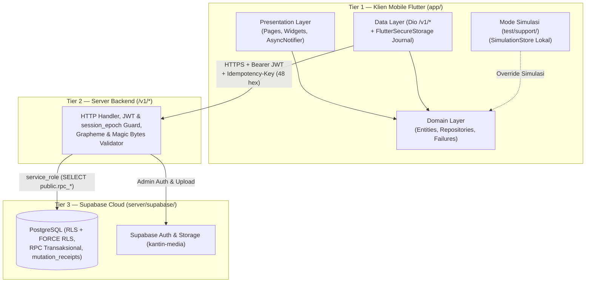
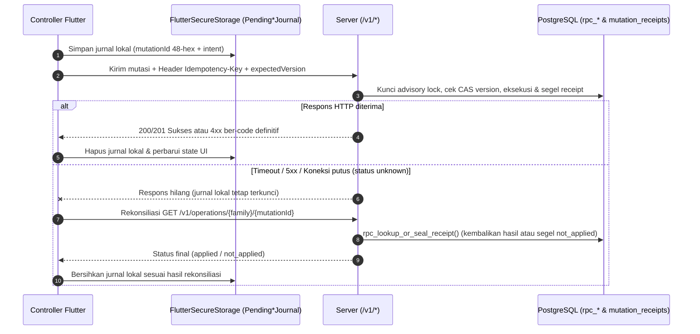

# Arsitektur dan Aturan Kode

Dokumen ini menjelaskan arsitektur 3-tier KantinCerdas, batas lapisan di dalam `app/lib/`, manajemen sesi dan jurnal idempotensi, serta aturan perubahan kode.

## 1. Arsitektur 3-Tier dan Pemisahan Mode

Entrypoint produksi `app/lib/main.dart` menjalankan `BootstrapApp` (`app/lib/app/bootstrap_app.dart`) $\rightarrow$ `bootstrap()` $\rightarrow$ `buildProductionOverrides()` $\rightarrow$ `KantinCerdasApp` (`MaterialApp.router`). Sebaliknya, entrypoint `app/test/support/main_simulation.dart` menjalankan `SimulationApp` dengan override repository lokal di memori/penyimpanan perangkat. Graf dependensi entrypoint produksi tidak boleh menjangkau implementasi simulasi.

- **Tier 1 (`app/`):** Menangani tampilan, validasi awal input dan *magic bytes* gambar, penyimpanan token sesi serta jurnal mutasi di `FlutterSecureStorage`, dan rekonsiliasi saat jaringan terputus. Klien tidak memakai `supabase_flutter` dan tidak pernah memegang kunci Supabase.
- **Tier 2 (`/v1/*`):** Memverifikasi JWT dan `session_epoch`, memvalidasi panjang karakter grapheme (`.characters.length`), memeriksa *magic bytes* unggahan gambar, menandatangani kursor paginasi, dan memanggil RPC PostgreSQL memakai `service_role`.
- **Tier 3 (`server/supabase/`):** Menegakkan `ENABLE` + `FORCE ROW LEVEL SECURITY` tanpa policy untuk `anon`/`authenticated`, menjaga invarian transaksi ACID, menolak konflik versi (`expected_version`), dan mencatat audit *append-only* di `public.audit_events`.

## 2. Struktur Modul dan Batas Clean Architecture

| Area | Path | Tanggung Jawab |
|---|---|---|
| Bootstrap & Router | `app/lib/app` | Inisialisasi (`bootstrap.dart`), komposisi DI produksi (`production_overrides.dart`), `GoRouter`, guard `auth_redirect.dart`, dan konstanta rute |
| Fitur Utama | `app/lib/features/{auth,customer,owner,admin}` | `domain/` (`entities`, `failures`, `repositories`, `providers`, `usecases`/`validation`), `data/` (`datasources`, `models`, `mappers`, `repositories`, `storage`, `providers`), dan `presentation/` |
| Pesanan Bersama | `app/lib/features/orders` | Entitas dan aturan pesanan lintas peran (`OrderRecord`, `MenuCategory`, `order_record_rules.dart`), model/mapper bersama, serta kartu dan label pesanan |
| Pengaturan & Shell | `app/lib/features/{settings,shell}` | Pengaturan tema/lokal (`settings_page.dart`), bantuan (`help_page.dart`), ketentuan (`terms_page.dart`), serta kerangka navigasi `CustomerShell`, `OwnerShell`, dan `AdminShell` |
| Core Infrastruktur | `app/lib/core` | Jaringan (`Dio`, `AuthInterceptor`, `AppEnvironment`, `mapDioException`), media (`ImageSecurityValidator`, `DioMediaUploadRepository`), konfigurasi (`AppFeatureFlags`, `AppBuildInfo`), sesi (`core/session/`), jurnal (`SecureMutationJournalBase`), utilitas, dan widget `Kc*` |
| Sistem Tema | `app/lib/theme` | Token warna, tipografi, spacing, radius, ukuran sentuh, dan tema Material (`KcTheme`) |
| Simulasi | `app/test/support/simulation` | Seed data fiktif, `SimulationStore`, receipt/jurnal simulasi, dan override yang terisolasi di luar `app/lib/` |

Batas ketergantungan antar-lapisan ditegakkan secara otomatis oleh `app/test/audit/architecture_boundary_test.dart`:

1. `lib/core/` tidak boleh mengimpor `lib/features/`.
2. `lib/features/*/presentation/` hanya bergantung pada `domain/` (termasuk `domain/providers/`) dan `core/`; dilarang mengimpor `features/*/data/` atau `Dio`.
3. `lib/features/*/domain/` bebas dari dependensi `data/`, `presentation/`, `package:flutter/`, `dio`, `shared_preferences`, dan `flutter_secure_storage`.
4. Penyuntikan implementasi `data/` ke provider kontrak `domain/` dan `core/session/` dilakukan terpusat di `buildProductionOverrides()` (`app/lib/app/production_overrides.dart`).
5. Kelas `*UseCase` dipertahankan pada fitur yang membutuhkan orkestrasi multi-langkah (seperti `features/auth/domain/usecases/`). Untuk fitur yang aturan bisnisnya sudah dienkapsulasi di dalam entitas/value object domain (`OrderDraft`, `CustomerOrderPriceConfirmation`, `Pending*Mutation`, `OwnerOrderTransition`), controller memanggil kontrak `Repository` domain secara langsung tanpa membuat kelas *pass-through UseCase* kosong.

## 3. Sesi, Invalidasi State, dan Protokol Idempotensi

- **Perlindungan Sesi Lintas `await`:** Notifier menangkap snapshot identitas dan generasi sesi sebelum operasi asinkron agar respons yang kembali setelah logout atau pergantian akun diabaikan.
- **Hak Akses Lintas Peran:** Pengguna yang dipromosikan menjadi `owner` tetap dapat mengakses fitur `customer` untuk akun pribadinya, sedangkan `admin` tidak mendapat bypass ke rute pribadi pelanggan.
- **Katalog dan Invalidasi:** `CustomerCatalog` dimuat sebagai snapshot utuh agar daftar menu umum dan detail stan selalu konsisten. Keranjang (`CartState`) membatasi pesanan pada satu stan yang buka dan menu yang tersedia. Checkout menginvalidasi daftar/detail pesanan; mutasi `owner` menginvalidasi katalog dan pesanan; mutasi `admin` menginvalidasi ringkasan, daftar pengguna, dan pengajuan.
- **Jurnal Mutasi dan Rekonsiliasi:** Enam keluarga mutasi (`orders`, `order-cancellations`, `canteen-applications`, `food-preferences`, `owner-mutations`, `admin-mutations`) mencatat ID 48-hex dan *intent* ke jurnal lokal sebelum request dikirim. Kegagalan jaringan yang meninggalkan status *unknown* mengunci aksi terkait hingga endpoint lookup `/v1/operations/{family}/{requestId}` memastikan apakah transaksi telah diterapkan (`applied`) atau disegel negatif (`not_applied`).

## 4. Aturan Pengembangan

1. Jangan mengakses layanan jaringan dari layer `presentation` atau mengarang hasil layanan; bila `API_BASE_URL` kosong, biarkan adapter mengembalikan `*NotConfiguredFailure` secara jujur.
2. Pertahankan seluruh kode simulasi di dalam `app/test/support/simulation/`; jangan memindahkan fixture simulasi ke `app/lib/`.
3. Setiap perubahan pada skema jurnal lokal memerlukan migrasi pembacaan, bukan penghapusan paksa entri *pending*.
4. Setiap perubahan pada kontrak entitas, batas validasi, atau kode error wajib diperbarui serentak pada model/mapper `data/`, simulator, pengujian, serta dokumen di [`docs/backend/SPESIFIKASI_BACKEND.md`](backend/SPESIFIKASI_BACKEND.md), [`docs/backend/KAMUS_DATA.md`](backend/KAMUS_DATA.md), dan [`docs/backend/PETA_INTEGRASI_FILE.md`](backend/PETA_INTEGRASI_FILE.md).
