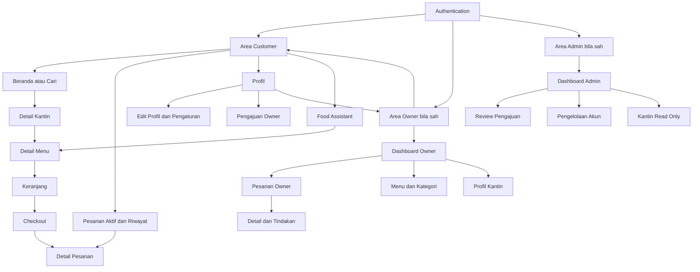

# Navigasi konseptual — bukan nama route final

## Shell navigasi

| Area | Root destinations | Subhalaman |
|---|---|---|
| Customer | **Beranda · Cari · (FAB robot) · Pesanan · Profil** | Detail Kantin, Detail Menu, Keranjang, Checkout, Detail Pesanan, Form Pengajuan, Edit Profil, Pengaturan, AI chat |
| Owner | **Beranda · Pesanan · Menu · Kantin** | Edit Menu, Kelola Kategori, Detail Order, Cari/Scan, Akun Owner |
| Admin | **Beranda · Pengajuan · Pengguna · Kantin** | Review detail, Detail Pengguna, Detail Kantin, Akun/Pengaturan |
| Auth | Tidak ada bottom navigation | Login, Register 1, Register 2, Verifikasi, Lupa, Reset |

- Back kembali ke konteks asal, bukan memaksa reset tab root.
- Beralih Owner ↔ Customer menggunakan akun/sesi sama; **bukan mengubah role database**.
- Setelah checkout sukses server terverifikasi, arahkan ke Detail Pesanan; jika jaringan tidak pasti, tampilkan pemulihan upaya checkout.
- FAB Robot Customer hadir di shell root, tidak di layar detail.
- Route IDs, path deep-link, dan library navigasi konkret tidak diputuskan oleh berkas UI.
